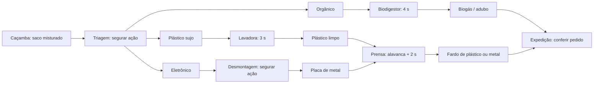

# Triagem, tratamento e pedidos

As cinco fases offline agora usam este fluxo. A fase 3 mantém os lados separados em Co-op Local; as demais continuam abertas. A montagem de robôs e os equipamentos antigos permanecem como recursos do projeto, enquanto as metas atuais das rooms passam a contar pedidos atendidos.

## Controles

J1 usa WASD para andar, G para dash e H para pegar/colocar. J2 usa setas, Num 2 e Num 3. Segure o mesmo botão de ação para trabalhar na triagem, na desmontagem ou com o extintor. O trabalho manual pausa ao soltar o botão ou sair do alcance; o progresso permanece na bancada. Duas jogadoras não aceleram a mesma bancada ao trabalhar no mesmo frame.

A triagem leva 2 segundos e a desmontagem 2,5 segundos. Os resultados da triagem são aleatórios em ciclos embaralhados dos três materiais. A lavadora e o biodigestor começam automaticamente ao receber o material correto. Na prensa, primeiro coloque o plástico limpo ou a placa de metal; depois aperte a ação novamente para acionar a alavanca. Ela demora 2 segundos. Cada equipamento comporta um material e só fica livre após retirar o resultado.

A caçamba gera sacos automaticamente. Se estiver vazia, a ação aciona a alavanca para gerar um saco; aperte novamente para pegá-lo. Sacos brutos não podem entrar na prensa nem ser entregues diretamente. Equipamentos recusam entradas incompatíveis sem destruir o item.

## Pedidos e pontuação

Três pedidos aparecem no topo da tela. As entregas válidas são fardo de plástico, fardo de metal e biogás/adubo. Uma entrega correspondente remove um pedido, dá 100 pontos e toca `snd_delivery_success`. Novos pedidos entram a cada 3 segundos enquanto houver menos de três ativos.

Uma entrega finalizada sem pedido correspondente é descartada e desconta 5 segundos; não pontua. Matérias-primas e itens intermediários são recusados e continuam nas mãos da jogadora. O caminhão mantém capacidade e tempo de viagem: encheu, sai automaticamente; com as mãos vazias, a ação também permite enviá-lo antes de encher. Durante a ausência, as entregas ficam bloqueadas sem consumir itens.

Todas as fases duram 120 segundos. As metas abaixo contam pedidos, não os 100 pontos por pedido:

| Fase | Local | 1 estrela | 2 estrelas | 3 estrelas | Intervalo por caçamba |
|---|---|---|---|---|---|
| 1 | Porto Novo | 3 | 5 | 7 | 10 s |
| 2 | Indaiá | 4 | 6 | 8 | 9 s |
| 3 | Centro | 5 | 7 | 9 | 12 s, duas caçambas |
| 4 | Martim de Sá | 6 | 8 | 10 | 8 s |
| 5 | Massaguaçu | 7 | 9 | 12 | 7 s |

É necessário sobreviver até o fim do tempo. Caçamba cheia por tempo excessivo ainda causa derrota. Vitórias atualizam o save selecionado e liberam a próxima fase. Os saves existentes de conclusão/estrelas continuam compatíveis. O código original de rede continua separado, usando seu protótipo anterior.

## Chorume e incêndios

Orgânico no chão por 8 segundos vira uma poça de chorume. Recolher o item zera esse tempo; apoiá-lo em bancada evita a deterioração no chão. A poça dura até sair/reiniciar a fase. Ao entrar nela, a personagem escorrega e fica 2 segundos sem andar, dar dash ou interagir. Não há atordoamento infinito por permanecer no mesmo lugar; sair e entrar novamente pode causar outro escorregão. O dash também detecta a poça durante o trajeto.

Eletrônicos no chão ou apoiados sem tratamento por 5 segundos entram em curto-circuito. O material vira eletrônico queimado e não pode ser recuperado. Trabalho ativo na desmontagem evita o superaquecimento. Enquanto o item queima, não pode ser recolhido nem processado.

Pegue o extintor no suporte, aproxime-se do fogo e segure a ação por 1 segundo. O primeiro aperto prioriza apagar o fogo, sem largar a ferramenta. Depois, apoie ou devolva o extintor, recolha o eletrônico queimado e leve ao lixo comum. Cada suporte empresta um extintor por vez; passar a ferramenta pelos blocos mantém esse empréstimo e outra jogadora pode devolvê-la.

As bancadas da fase 3 passam sacos, intermediários, produtos finais e extintores. Eletrônicos também podem incendiar nesses blocos; orgânicos apoiados não viram chorume.

## Editar no GameMaker

Todas as máquinas e materiais têm sprites e objetos reais, posicionados nas rooms:

- `obj_intake_bin`: caçamba.
- `obj_sorting_table`: triagem.
- `obj_washer`: lavadora.
- `obj_biodigester`: biodigestor.
- `obj_dismantling_bench`: desmontagem.
- `obj_hydraulic_press`: prensa.
- `obj_dispatch_truck`: caminhão.
- `obj_common_trash`: descarte comum.
- `obj_extinguisher_rack`: suporte da ferramenta.
- `obj_material_*`: sacos, materiais, produtos e extintor.
- `obj_leachate`: poça.

As artes `spr_material_*`, `spr_machine_*`, `spr_fire` e `spr_leachate` são placeholders substituíveis. O som também é um recurso de áudio editável.

As instâncias das máquinas expõem `process_duration`, `spawn_interval`, `capacity` e `return_duration`. O controlador expõe `processing_enabled`, `wrong_delivery_penalty`, `points_per_order`, `organic_decay_time`, `electronic_overheat_time`, `slip_stun_duration`, `extinguish_duration` e as metas/duração da fase. Os layouts continuam sendo lidos do Room Editor, sem criar ou reposicionar equipamentos por código.

A implementação está em `scr_processing_flow` e `scr_processing_draw`. Textos, barras e indicadores permanecem dinâmicos; os desenhos usam sprites.

## Verificação

`node tools/validate-resources.mjs` confere os recursos, imagens, sons e instâncias.

`node tools/prepare-processing-tests.mjs` cria uma cópia isolada em `%TEMP%/GameJamIf2026-processing-tests`, com o teste GML de `tests/processing`. Compile e execute essa cópia para obter `PROCESSING_PROBE_PASSED`. O teste usa comandos de teclado simulados apenas na cópia e desativa escrita de saves reais. Ele cobre os três fluxos completos, duração, ação mantida/solta, disputa entre jogadoras, alavancas, pedidos certos/errados, timers de chorume e fogo, atordoamento, extintor, descarte, divisão/solo e estrelas.

Após executar o runner com saída em `run.log`, `node tools/check-processing-layouts.mjs` verifica acesso aos equipamentos e circulação nas arenas. A compilação validada usa o runtime Windows VM 2024.14.4.268.
